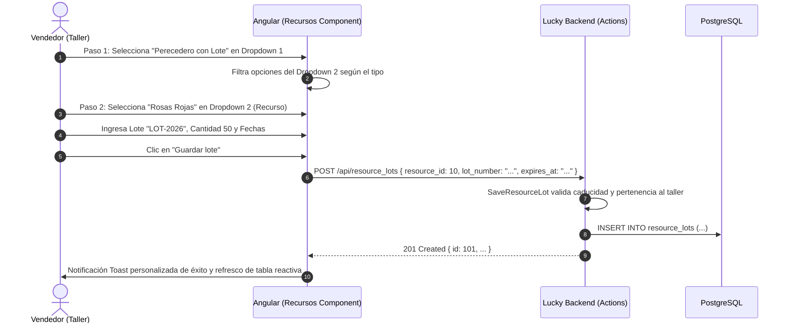

# ForgeWorks — Administración MVC para el Core de Cotización y Encargos


Plataforma multi-taller de cotizaciones y encargos con estado para todo tipo de productos hechos a medida. 

Este módulo implementa la **Administración MVC que alimenta al Core de ForgeWorks**, permitiendo la gestión segura de talleres (`Workshop`), sus recursos e insumos (`Resource`) y el inventario físico con fechas de caducidad (`ResourceLot`), cumpliendo con los requisitos de **validación de datos sensibles en el servidor** y **relaciones entre tablas con dropdowns en cascada**.

---

## 📑 Tabla de Contenidos

1. [📹 Video Demostrativo](#-video-demostrativo)
2. [🧠 Justificación: ¿Por qué esto alimenta al Core?](#-justificación-por-qué-esto-alimenta-al-core)
3. [🚨 Validación en Back-End de Datos Sensibles](#-validación-en-back-end-de-datos-sensibles)
4. [⛓️ Relación entre Tablas con Dropdown en Cascada y Lotes Iniciales](#️-relación-entre-tablas-con-dropdown-en-cascada-y-lotes-iniciales)
5. [🔒 Aislamiento Multi-Taller Estricto (RF-02)](#-aislamiento-multi-taller-estricto-rf-02)
6. [🏛️ Arquitectura MVC del Tech Stack](#️-arquitectura-mvc-del-tech-stack)
7. [🛠️ Endpoints de la API](#️-endpoints-de-la-api)
8. [🚀 Puesta en Marcha (Instalación Local)](#-puesta-en-marcha-instalación-local)

---

## 📹 Video Demostrativo
<p align="center">
  <a href="https://youtu.be/98zBya63qEE">
    
  </a>
</p>

---

## 🧠 Justificación: ¿Por qué esto alimenta al Core?

El principio fundamental de ForgeWorks es: **«El proceso es un dato, no código»**.
1. **El Core no tiene insumos cableados en el código:** El evaluador recursivo de condiciones del backend solo procesa referencias (`r.`, `d.`, `v.`, `c.`).
2. **El estado compartido del taller acopla las decisiones:** Cuando un cliente navega el configurador de un producto, el motor evalúa en vivo si hay suficiente stock de roble, resina o flores. Si el taller no alimenta sus recursos y lotes de inventario, el motor no puede cotizar ni reencaminar encargos en tiempo real.
3. **Conclusión:** Esta administración es la **fuente de datos vivos del taller** que nutre al motor de decisiones.

---

## 🚨 Validación en Back-End de Datos Sensibles

Para cumplir con la consigna de que los datos sensibles no dependan de validaciones perimetrales en JavaScript, se blindaron dos capas críticas en el servidor Crystal/Lucky:

### 1. Cédula y RUC Ecuatoriano (Módulo 10 y Módulo 11)
Archivo: [`src/utils/identification_validator.cr`](forgeworks_api/src/utils/identification_validator.cr) y mixin [`src/operations/mixins/identification_validations.cr`](forgeworks_api/src/operations/mixins/identification_validations.cr).
* **Cédula (10 dígitos):** Validación de código de provincia (01 a 24, o 30), tercer dígito menor a 6 y algoritmo oficial de **Módulo 10** con coeficientes `[2, 1, 2, 1, 2, 1, 2, 1, 2]`.
* **RUC Persona Natural (13 dígitos):** Los primeros 10 dígitos deben ser una cédula matemáticamente válida y los 3 dígitos finales (código de establecimiento) no pueden ser `000`.
* **RUC Sociedad Privada (13 dígitos):** Tercer dígito igual a 9 y algoritmo oficial de **Módulo 11** con coeficientes `[4, 3, 2, 7, 6, 5, 4, 3, 2]`.
* **RUC Entidad Pública (13 dígitos):** Tercer dígito igual a 6 y algoritmo oficial de **Módulo 11** con coeficientes `[3, 2, 7, 6, 5, 4, 3, 2]`.

### 2. Caducidad de Insumos Perecederos
Archivo: [`src/operations/save_resource_lot.cr`](forgeworks_api/src/operations/save_resource_lot.cr).
* Si el recurso es de tipo `perecedero` (flores, resinas, alimentos), el backend rechaza la transacción con `HTTP 422` si:
  * `expires_at` es nulo o vacío.
  * `expires_at <= received_at` (la fecha de caducidad es menor o igual al ingreso).
  * `expires_at < Time.utc` (el lote que se intenta ingresar ya está vencido).

### 3. Dinero Entero en Centavos
Archivo: [`src/operations/save_resource.cr`](forgeworks_api/src/operations/save_resource.cr).
* Los costos se almacenan como `Int64` de centavos enteros (`cost_cents > 0`) para evitar errores de redondeo de punto flotante en la cotización.

---

## ⛓️ Relación entre Tablas con Dropdown en Cascada y Lotes Iniciales

Para vincular las existencias físicas (`ResourceLot`) con los insumos del taller (`Resource`), la interfaz no permite ingresar claves foráneas manualmente, garantizando la integridad de datos mediante dos flujos seguros:

### 1. Registro Directo de Perecederos con Lote Inicial Obligatorio
Al registrar un recurso de tipo `perecedero` en el modal de **"Registrar nuevo recurso"**, el sistema despliega automáticamente una tarjeta integrada donde el usuario debe configurar el primer lote físico, exigiendo código de lote, cantidad inicial y fecha de caducidad futura. Al confirmar, el backend encadena la creación del recurso y su lote físico de manera transaccional.

### 2. Ingreso de Lotes Posteriores con Dropdown Dependiente en Cascada
Para ingresar lotes adicionales a recursos ya existentes, el modal de ingreso físico opera mediante un selector en cascada dependiente:

$$\text{Tipo de Insumo (Filtro)} \xrightarrow{\text{consulta reactiva}} \text{Recursos del Taller} \xrightarrow{\text{asocia FK}} \text{Lote de Inventario}$$



---

## 🔒 Aislamiento Multi-Taller Estricto

Para garantizar la seguridad de los datos:
1. **Sesión Activa:** El token JWT emitido al iniciar sesión amarra al usuario a su `workshop_id`.
2. **Roles en el Sistema:**
   - **`Admin`:** Dueño del taller. Configura insumos, costos y gestiona colaboradores.
   - **`Vendor`:** Gestor comercial de cara a cotizaciones y clientes.
   - **`Staff`:** Operario de taller que registra lotes de inventario y avances de producción.
   - **`Client`:** Comprador externo (`workshop_id = nil`).

---

## 🏛️ Arquitectura MVC del Tech Stack

| Capa MVC | Tecnología | Componentes Clave | Responsabilidad |
| :--- | :--- | :--- | :--- |
| **🧠 Modelo** | **Avram ORM & Operations (Crystal)** | • [`workshop.cr`](forgeworks_api/src/models/workshop.cr) \| [`save_workshop.cr`](forgeworks_api/src/operations/save_workshop.cr)<br>• [`resource.cr`](forgeworks_api/src/models/resource.cr) \| [`save_resource.cr`](forgeworks_api/src/operations/save_resource.cr)<br>• [`resource_lot.cr`](forgeworks_api/src/models/resource_lot.cr) \| [`save_resource_lot.cr`](forgeworks_api/src/operations/save_resource_lot.cr)<br>• [`identification_validator.cr`](forgeworks_api/src/utils/identification_validator.cr) | Define la estructura de datos en PostgreSQL, reglas de integridad referencial, algoritmos matemáticos y validaciones de datos sensibles. |
| **👁️ Vista** | **Angular SPA & Serializers** | • [`recursos.ts`](forgeworks-web/src/app/pages/recursos/recursos.ts) \| [`recursos.html`](forgeworks-web/src/app/pages/recursos/recursos.html) \| [`recursos.scss`](forgeworks-web/src/app/pages/recursos/recursos.scss)<br>• [`workshop_serializer.cr`](forgeworks_api/src/serializers/workshop_serializer.cr)<br>• [`resource_serializer.cr`](forgeworks_api/src/serializers/resource_serializer.cr)<br>• [`resource_lot_serializer.cr`](forgeworks_api/src/serializers/resource_lot_serializer.cr) | Renderiza la interfaz reactiva con Signals, gestiona la cascada visual, toasts, diálogos y formatea las respuestas JSON de la API. |
| **🎮 Controlador** | **Lucky Actions (Crystal)** | • [`api_action.cr`](forgeworks_api/src/actions/api_action.cr)<br>• `Api::Workshops::*` ([`mine.cr`](forgeworks_api/src/actions/api/workshops/mine.cr), [`create.cr`](forgeworks_api/src/actions/api/workshops/create.cr))<br>• `Api::Resources::*` ([`index.cr`](forgeworks_api/src/actions/api/resources/index.cr), [`create.cr`](forgeworks_api/src/actions/api/resources/create.cr))<br>• `Api::ResourceLots::*` ([`index.cr`](forgeworks_api/src/actions/api/resource_lots/index.cr), [`create.cr`](forgeworks_api/src/actions/api/resource_lots/create.cr)) | Recibe peticiones HTTP, valida JWT, aplica aislamiento por taller y coordina operaciones y serializadores. |

---

## 🛠️ Endpoints de la API

### Talleres (`/api/workshops`)
* `GET /api/my_workshop` — Obtiene el taller de la sesión actual.
* `POST /api/workshops` — Registra un nuevo taller (**valida Cédula/RUC con Módulo 10**).
* `GET /api/workshops/:workshop_id` — Consulta detalle de un taller.
* `PUT /api/workshops/:workshop_id` — Actualiza datos del taller.

### Recursos (`/api/resources`)
* `GET /api/resources` — Lista recursos del taller (admite `?resource_type=` para el dropdown en cascada).
* `POST /api/resources` — Crea un insumo asociándolo automáticamente al taller activo.
* `GET /api/resources/:resource_id` — Consulta individual de recurso.
* `PUT /api/resources/:resource_id` — Modificación de recurso.
* `DELETE /api/resources/:resource_id` — Baja lógica del recurso (`is_active = false`).

### Lotes de Inventario (`/api/resource_lots`)
* `GET /api/resource_lots` — Lista lotes físicos (admite `?resource_id=`).
* `POST /api/resource_lots` — Registra un lote (**valida fecha de caducidad para perecederos**).
* `GET /api/resource_lots/:lot_id` — Detalle del lote.
* `PUT /api/resource_lots/:lot_id` — Actualización de lote.
* `DELETE /api/resource_lots/:lot_id` — Eliminación de lote.

---

## 🚀 Puesta en Marcha (Instalación Local)

### Prerrequisitos
* **Crystal:** `1.20+`
* **Node.js:** `v20+` y `npm`
* **PostgreSQL:** `14+` en puerto local `5432`

### 1. Backend (Lucky Framework)
```bash
cd forgeworks_api

# Instalar dependencias de Crystal
shards install

# Configurar variables de entorno si es necesario (.env)
# Correr migraciones de base de datos
crystal run tasks.cr -- db.migrate

# Iniciar servidor en http://localhost:3000
crystal run src/start_server.cr
```

### 2. Frontend (Angular 20+)
```bash
cd forgeworks-web

# Instalar paquetes
npm install

# Iniciar servidor de desarrollo en http://localhost:4200
npm start
```
Abrir el navegador en `http://localhost:4200`, iniciar sesión y navegar a `/recursos`.

---

## ☁️ Despliegue Automatizado en Render (Blueprint)

El repositorio incluye el archivo de infraestructura como código [`render.yaml`](render.yaml) para desplegar toda la plataforma con un solo clic:

1. **Base de Datos PostgreSQL Gestionada:** Instancia `forgeworks-db` con esquema `forgeworks_api_production`.
2. **Backend Web Service (`forgeworks-api`):** Contenedor Docker compilado en Crystal 1.20 con Lucky Framework, con ejecución automática de migraciones (`db.migrate`) al arrancar.
3. **Frontend SPA (`forgeworks-web`):** Sitio estático con CDN global y reescritura de rutas para Angular (`/* -> /index.html`).

### Pasos para desplegar en Render:
1. Conecta tu repositorio de GitHub en [dashboard.render.com](https://dashboard.render.com/).
2. Haz clic en **"New +"** y selecciona **"Blueprint"**.
3. Elige el repositorio `forgeworks`. Render detectará automáticamente el archivo `render.yaml` y orquestará la base de datos, el backend y el frontend de forma sincronizada.
